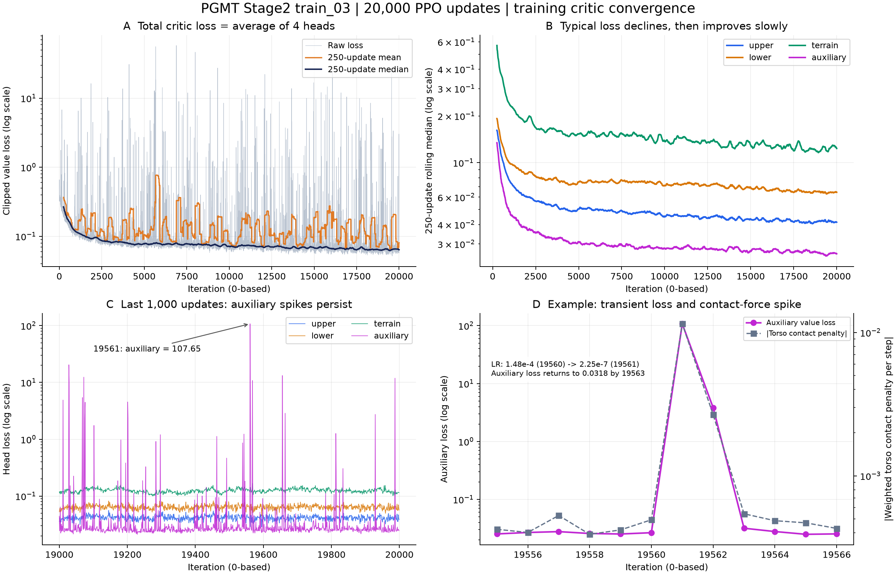

# Stage2 train_03 的 critic loss 收敛情况

**常态误差已明显下降，约 4000 轮后进入缓慢改善阶段；auxiliary 价值头仍有严重的偶发尖峰，因此不能称为完全平稳收敛。** 后期没有持续性 loss 发散，但尖峰直到训练结束前仍存在。

训练目录：`/home/lzp/projects/perceptive_tracking/PMT/logs/pgmt_stage2_center2x2/train_03`。本次于 2026-11-11 从原始 `progress.jsonl` 重新读取全部 20,000 轮，并与已有提取数组逐项比对；额外抽查 TensorBoard 最初 3 轮的 15 个 value-loss 标量，结果一致，仅有 float32 存储精度差。索引为从 0 开始的 iteration。

## Loss 定义

四个价值输出为 `upper / lower / terrain / auxiliary`。日志中的 `Loss/value_function` 是四个头损失的**平均值**，不是总和。每个头记录 PPO clipped value loss：

```text
V_clipped = V_old + clamp(V - V_old, -0.2, 0.2)
L_head = mean(max((V - return)^2, (V_clipped - return)^2))
L_value = mean(L_upper, L_lower, L_terrain, L_auxiliary)
```

每轮日志再平均本轮 5 epochs × 4 minibatches 的更新。四个头的 return 数值尺度不同，因此不能只凭某个头的绝对 loss 较大，判断它更难学习或价值预测质量更差。定义见 [ppo.py](../../../../../motion_tracking_rl/algorithms/ppo.py) 的 value loss 与逐头日志计算。

这次从 Stage1 `model_15000.pt` 初始化，`launch.json` 的 `resume=null`，实际 iteration 连续 0–19999，没有日志中的续训断点。

## 整体和各头趋势

下表使用窗口中位数，避免少量极大尖峰掩盖常态趋势。

| 指标 | 首 1000 轮 0–999 | 末 1000 轮 19000–19999 | 降幅 |
| --- | ---: | ---: | ---: |
| 总 value loss | 0.15872 | 0.06462 | 59.3% |
| upper | 0.09977 | 0.04168 | 58.2% |
| lower | 0.12445 | 0.06418 | 48.4% |
| terrain | 0.32469 | 0.12463 | 61.6% |
| auxiliary | 0.07125 | 0.02583 | 63.7% |

总 loss 的分段中位数：

| iteration 窗口 | 中位数 |
| --- | ---: |
| 0–99 | 0.32679 |
| 1000–1999 | 0.09879 |
| 4000–4999 | 0.07709 |
| 9000–9999 | 0.07341 |
| 14000–14999 | 0.06874 |
| 19000–19999 | 0.06462 |

前几千轮下降最快；4000 轮以后趋于平台，但仍缓慢下降，不能说早期后完全不再学习。末 1000 轮 upper/lower/terrain 的均值分别为 0.04173/0.06405/0.12491，接近各自中位数，波动相对稳定。

总 loss 最后一个点是 **0.05871**，但它不能代表整个末段。末 1000 轮中位数为 **0.06462**、P95 为 **0.07845**，均值却是 **0.12258**；均值显著抬高来自少数辅助头尖峰。末段总 loss 的 P99 为 1.18410、最大值为 26.96161。

## 辅助价值头的尾部不稳定

| auxiliary 指标 | 全部 20000 轮 | 末 1000 轮 |
| --- | ---: | ---: |
| 中位数 | 0.02937 | 0.02583 |
| P95 | 0.12813 | 0.08572 |
| 最大值 | 231.33694 | 107.64706 |
| loss 大于 1 的轮数 | 387 | 21 |
| loss 大于 10 的轮数 | 113 | 7 |

全程最大值在 iteration **6890**：auxiliary=231.33694，使总 loss 达到 **57.90026**；该轮辅助头贡献了四头损失和约 99.9%。末 1000 轮辅助头均值为 0.25962，是中位数的约 10 倍，并占四头累计损失和约 53%。这解释了为什么总 loss 的平均曲线看起来频繁起伏，而各头中位数曲线相当平滑。

后期典型事件：

| iteration | auxiliary loss | 总 loss | torso 接触力奖励贡献 | 轮末学习率 |
| --- | ---: | ---: | ---: | ---: |
| 19560 | 0.02660 | 0.05863 | -0.000493 | 1.48e-4 |
| 19561 | 107.64706 | 26.96161 | -0.011505 | 2.25e-7 |
| 19562 | 3.83193 | 1.02301 | -0.002672 | 6.57e-5 |
| 19563 | 0.03176 | 0.06673 | -0.000543 | 6.57e-5 |

尖峰后两轮即可恢复到通常量级，属于瞬时不稳定，而不是后期持续爆炸。学习率下降与这次尖峰同时发生；代码里的学习率调整实际由 minibatch KL 阈值触发，不是直接由 critic loss 触发。

全程 `log(auxiliary loss)` 与 `log(|auxiliary_anchor_contact_force 奖励贡献|)` 的相关系数为 **0.9132**。对应奖励对 torso/anchor 接触力取平方和，权重为负，缺少像加速度项那样的上限。这是值得优先定位的异常来源，区别于 terrain 头中的双脚接触力惩罚。逐轮均值只能支持关联，不能确定是哪条动作、哪个环境的碰撞，也不能单凭它判定物理数值异常。

## 结论的范围

所分析的 loss、KL、学习率与力惩罚记录全部有限，训练正常完成。基于这些日志，可以判断 upper/lower/terrain 常态误差已大体稳定，auxiliary 的常态误差也下降，但尾部风险没有消失。

日志没有独立验证集 value error、return 方差或 explained variance；课程与动作采样分布也在变化。因此这里的“收敛”是训练 loss 趋势，不等同于 critic 已充分拟合、策略最优或最终 checkpoint 最佳。若为后续世界模型训练选择初始化权重，不能仅根据最后一轮 value loss 最小来选择。



原始重算结果见 [statistics.json](statistics.json)，逐轮提取值见 [critic_series.npz](critic_series.npz)，可导出矢量图见 [critic_convergence.svg](critic_convergence.svg)。图中平滑线为 250 轮 trailing median 或 mean，原始尖峰保留在 A/C 图中。

复跑脚本仅读取原始训练文件，重建本目录的派生分析文件，不启动仿真或修改权重：

```bash
/home/lzp/projects/instantTrack/.venv/bin/python \
  /home/lzp/projects/perceptive_tracking/PMT/logs/pgmt_stage2_center2x2/train_03/analysis/critic_convergence_20261111/analyze.py
```
