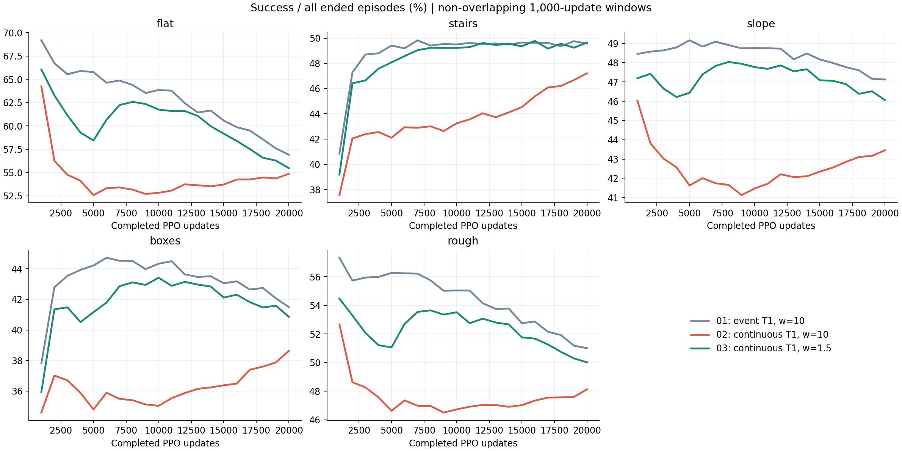
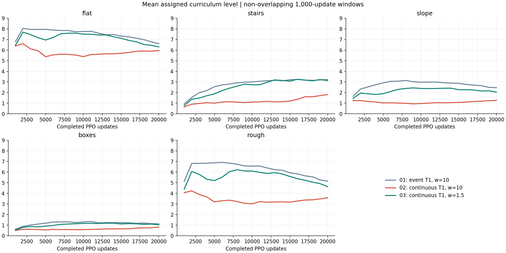
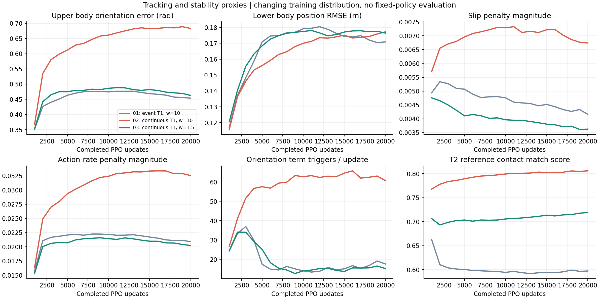
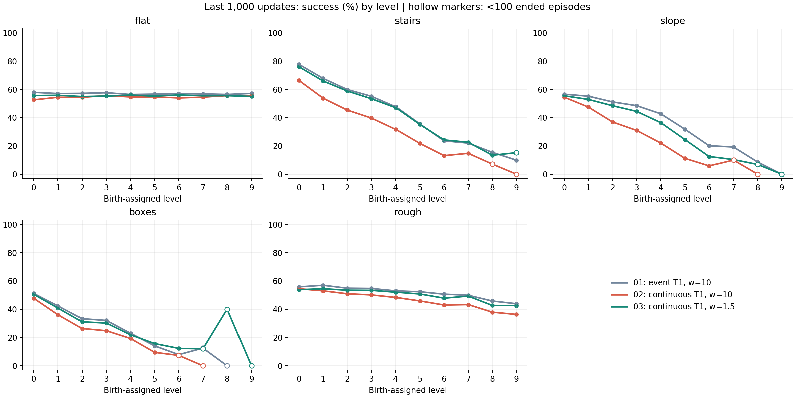
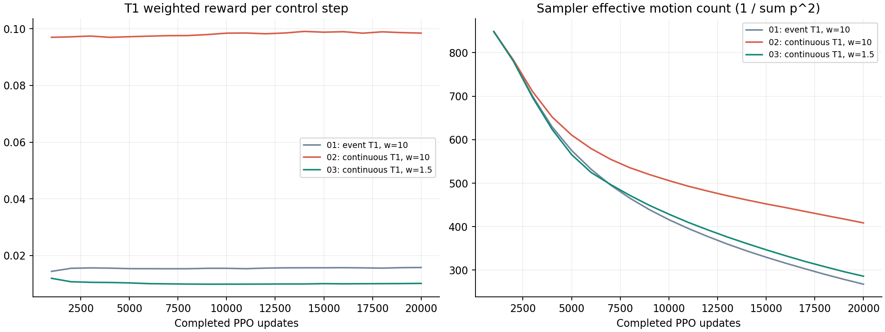
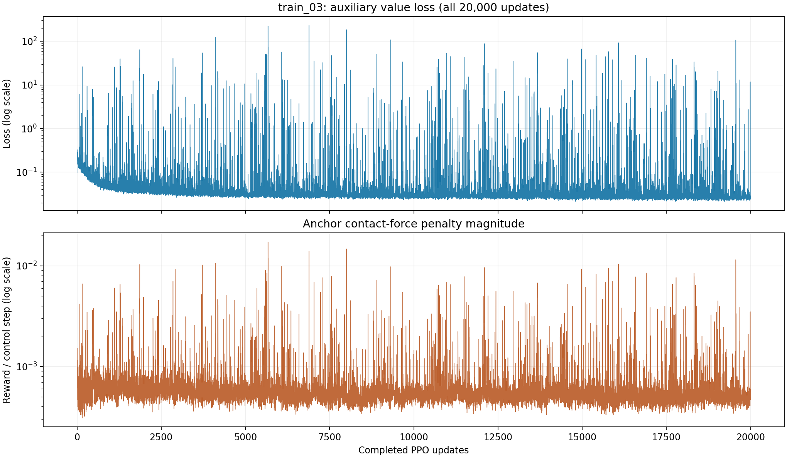

# PGMT Stage2 train_03 训练效果分析

分析日期：2026-10-21。最终 checkpoint：`logs/pgmt_stage2_center2x2/train_03/model_19999.pt`。

## 结论

将持续 T1 权重从 10 降到 1.5 后，上身姿态/位置跟踪、脚滑移和动作平滑性明显恢复；双脚接触约束的收益仍有保留。train_03 比 train_02 更适合作为下一步基线，但整体任务能力主要恢复到 train_01 附近，尚未证明超过旧模型或解决平地行走稳定性。

剩余问题是：躯干高度失败多、后期平地和 rough 成功率下降、中高难度 slope/boxes 能力有限，以及辅助价值损失偶发尖峰。最终 model_19999 尚没有固定动作集、相同初始条件的独立评测，本报告不把训练窗口成功率当作该 checkpoint 的评测成功率。

## 训练与配置核对

- train_03 正常完成 20,000 次 PPO 更新，8192 环境，每轮 24 控制步，共 3,932,160,000 条环境转移，训练循环约 34.16 小时。
- 原生 Isaac Sim 5.1、cuda:1、headless=True；从 Stage1 model_15000.pt 重新初始化，没有从 train_02 续训。seed=722；每 500 轮保存。
- 三次训练初始化 checkpoint SHA256 完全一致。train_02→train_03 的序列化 training_contract 唯一差异是 `rewards.terrain_touchdown_quality.weight: 10.0 → 1.5`；持续结算 `support_pattern_mean_v2` 未变。配置一致不等于证明执行代码及随机采样轨迹逐项相同。
- 已确认 checkpoint 中权重为 1.5。Python 默认常量仍为 10，但正式 builder 用 YAML 覆盖，未影响这次训练。tracking_relaxation=False。
- 日志逐轮验证迭代连续、结果计数增量匹配累计值、累计结果匹配 checkpoint、结果总数匹配 done 审计、环境总数及地形分配恒定、平均等级匹配人数加权值、奖励分组和一致；所抽取的全部数值有限。

## 末 1000 轮的地形表现

窗口为 iteration 19000–19999。成功率 = 完整动作跟踪成功数 / 所有结束回合数，包含失败和中性截断。以下不是只统计成功与失败，也不是平均每轮百分比。

| 地形 | train_01 成功率 | train_02 成功率 | train_03 成功率 | 03−02 | 02 平均等级 | 03 平均等级 | 03 结束回合数 |
|---|---:|---:|---:|---:|---:|---:|---:|
| flat | 56.90% | 54.86% | 55.46% | +0.60 pp | 5.97 | 6.30 | 99,448 |
| stairs | 49.58% | 47.22% | 49.65% | +2.43 pp | 1.81 | 3.12 | 104,627 |
| slope | 47.13% | 43.45% | 46.06% | +2.60 pp | 1.26 | 2.04 | 106,298 |
| boxes | 41.50% | 38.64% | 40.86% | +2.22 pp | 0.81 | 1.03 | 110,731 |
| rough | 51.01% | 48.13% | 50.02% | +1.89 pp | 3.58 | 4.62 | 102,849 |

总体成功率：train_01 49.04%；train_02 46.23%；train_03 48.24%。train_03 最后窗口记录 252,748 次成功、270,421 次失败、784 次越界，总计 523,953 次结束。

所有地形相对 train_02 均改善，且 stairs/slope/boxes/rough 的平均分配等级更高。总体成功率仅提高约 2 个百分点，部分原因是策略在更高等级运行；动作级采样也会改变动作组成，因此不能将总体百分比差值直接解释为固定测试集上的能力提升。flat 的十级几何相同，等级不是平地几何难度。

同等级的对比更能显示部分地形恢复，但仍未控制动作分布：stairs L3 从 39.73% 到 53.42%，L5 从 21.74% 到 35.17%；slope L3 从 30.97% 到 44.44%，L5 从 11.20% 到 24.50%。

与 train_01 相比，train_03 的总体成功率低约 0.8 个百分点；楼梯大体相当，斜坡特别是较高等级仍未恢复到旧水平。例如 slope L5：train_01 31.82%、train_03 24.50%。

## 姿态、平滑性与接触匹配

除另注明外，奖励为已经乘过 weight 和 dt 的平均单控制步贡献；惩罚栏取绝对值，越小越好。TrackingSnapshot 是全环境后更新快照，不是单个走路动作、不是 torso 单体倾角，也不是全身重心误差。

| 指标 | train_01 | train_02 | train_03 | 03 相对 02 |
|---|---:|---:|---:|---:|
| 上身姿态误差 rad | 0.453647 | 0.683112 | 0.462614 | -32.3% |
| 上身位置 RMS m | 0.114344 | 0.141854 | 0.113095 | -20.3% |
| 上身关节 RMS rad | 0.293134 | 0.427264 | 0.290922 | -31.9% |
| 下身位置 RMS m | 0.170881 | 0.177203 | 0.176448 | -0.4% |
| 下身姿态误差 rad | 0.463425 | 0.458960 | 0.460658 | +0.4% |
| Slip 惩罚绝对值 | 0.004162 | 0.006740 | 0.003624 | -46.2% |
| Action-rate 惩罚绝对值 | 0.020912 | 0.032534 | 0.020228 | -37.8% |
| 双腕加速度不匹配惩罚绝对值 | 0.012027 | 0.019392 | 0.012329 | -36.4% |
| T5 惩罚绝对值 | 0.007348 | 0.010499 | 0.007251 | -30.9% |
| root 姿态奖励 | 0.007492 | 0.006418 | 0.007324 | +14.1% |
| root 速度奖励 | 0.034212 | 0.032978 | 0.034190 | +3.7% |
| 躯干姿态失败触发数/轮 | 17.613000 | 60.663000 | 15.216000 | -74.9% |

上身姿态误差 −32.3%，Slip 惩罚 −46.2%，Action-rate 惩罚 −37.8%，姿态失败触发数 −74.9%。下身位置/姿态/关节快照并未同步大幅改善，不能概括成“全身跟踪全面提升”。

T2 平均接触匹配分数：train_01 59.71%、train_02 80.58%、train_03 71.89%。降权后丢失约 8.69 个百分点，仍比事件版高约 12.18 个百分点。这是有效标签对应的逐脚匹配平均分数；使用全对象接触力范数判据，并非 T1 的整体承重匹配率。

T1 质量加权门控得分由平均奖励除以 weight×dt 得到：train_02 0.4923，train_03 0.3400。它还包含脚下质量、几何有效性与是否有参考支撑脚，不能称为纯支撑模式匹配率。事件版 T1 是不同的随机变量，不能与这两个分数作匹配率比较。

## 奖励贡献与训练目标

| 奖励项 | train_01 | train_02 | train_03 |
|---|---:|---:|---:|
| upper_body_position | 0.015724 | 0.012704 | 0.015575 |
| upper_body_orientation | 0.007643 | 0.002226 | 0.007303 |
| upper_body_linear_velocity | 0.005003 | 0.003716 | 0.004961 |
| upper_body_angular_velocity | 0.000047 | 0.000006 | 0.000045 |
| upper_joint_position | 0.013296 | 0.008018 | 0.013150 |
| upper_joint_velocity | 0.002209 | 0.000879 | 0.002154 |
| lower_body_position | 0.006692 | 0.006321 | 0.006838 |
| lower_body_orientation | 0.023388 | 0.021206 | 0.024240 |
| lower_body_linear_velocity | 0.003914 | 0.004304 | 0.004704 |
| lower_body_angular_velocity | 0.000758 | 0.000975 | 0.001213 |
| lower_joint_position | 0.007106 | 0.006696 | 0.007167 |
| lower_joint_velocity | 0.004311 | 0.004684 | 0.005136 |
| auxiliary_root_orientation | 0.007492 | 0.006418 | 0.007324 |
| auxiliary_root_velocity | 0.034212 | 0.032978 | 0.034190 |
| auxiliary_anchor_position | 0.017810 | 0.017250 | 0.017805 |
| auxiliary_base_acceleration | -0.002142 | -0.002325 | -0.002011 |
| auxiliary_end_effector_acceleration | -0.012027 | -0.019392 | -0.012329 |
| auxiliary_action_rate | -0.020912 | -0.032534 | -0.020228 |
| auxiliary_joint_limit | -0.002723 | -0.004574 | -0.002662 |
| auxiliary_undesired_contacts | -0.002029 | -0.001487 | -0.001926 |
| auxiliary_anchor_contact_force | -0.000553 | -0.000741 | -0.000557 |
| terrain_touchdown_quality | 0.015805 | 0.098458 | 0.010199 |
| terrain_reference_contact_match | 0.017914 | 0.024173 | 0.021567 |
| terrain_slip | -0.004162 | -0.006740 | -0.003624 |
| terrain_stumble | -0.001361 | -0.001549 | -0.001414 |
| terrain_contact_switching | -0.007348 | -0.010499 | -0.007251 |
| terrain_contact_force | -0.003093 | -0.002942 | -0.002836 |
| total | 0.126970 | 0.168230 | 0.128731 |

四组奖励 train_03 为 upper=0.043186、lower=0.049297、terrain=0.016642、auxiliary=0.019605；auxiliary 从 train_02 的 −0.004407 恢复为正。T1 单步均值降到 0.010199（上限 0.03），不再以 train_02 的 0.098458 均值占据大量奖励。

总 reward 从 0.168230 降到 0.128731 是奖励定义尺度变化后的结果，不能据此判定性能下降。四头 advantage 先相加、后统一归一化，奖励尺度仍可影响 actor；value loss 也会通过共享编码器影响表征。奖励均值与 value 输出头梯度都不能直接等同于各目标对 actor 的梯度贡献。

## 后期走势和剩余失败

- train_03 中段 7000–7999 的总体成功率约 51.00%，最后窗口为 48.24%；flat 从中段 62.58% 降至 55.46%，rough 从 53.66% 降至 50.02%。stairs 平均等级仍由中段约 2.61 升到 3.12；flat/rough 等级后期下降。
- 862 个动作的采样有效数量 `1/sum(p²)` 从首窗口约 848 降到末窗口约 286；难动作权重明显集中。最终高概率动作包括 walk3_subject1_clip18/19/20/21 和 fallAndGetUp 片段。概率是全库基础采样概率，地形兼容过滤后实际概率会重新归一化。
- 因此后期成功率下降可能同时包含采样向难动作集中和能力变化，不能仅凭训练日志判定遗忘或选出最佳 checkpoint。flat 几何没有变难，值得固定动作集复测；建议比较现存 model_10000、model_15000、model_17500、model_19999。
- 躯干高度失败从 train_02 的 38.486 次/轮升到 train_03 的 140.325 次/轮，接近 train_01 的 137.975；水平偏离为 105.013 次/轮，姿态失败 15.216、手腕高度失败 11.800。各终止项可能同一步同时触发，不可将计数直接相加为独立失败回合数。
- 躯干高度失败条件是实际 torso 与“当前位置地形高度＋动作原始 torso 高度”的差超过 0.4 m 且持续 0.2 s；它可能对应倒地、蹲低、地形适应或动作跟踪失败，现有汇总无法区分原因。需要按动作和地形追踪终止前状态。
- 不建议仅因高度失败多就放宽 termination。先检查具体动作及状态，避免掩盖真正失败。

末窗口 L5 成功率与样本数：

| 地形 | L5 成功率 | 结束回合数 |
|---|---:|---:|
| flat | 55.25% | 8,902 |
| stairs | 35.17% | 16,004 |
| slope | 24.50% | 6,717 |
| boxes | 15.69% | 937 |
| rough | 50.78% | 12,895 |

stairs L9 仅 92 个样本；slope L8/L9 仅 29/2；boxes L7/L8/L9 仅 25/5/2。不要用这些小样本点宣称高难度通过率；图中以空心点标示 <100 个结束回合的格子，无样本格子留空。

## 数值尖峰：仍需处理的独立问题

- 所抽取的 loss、奖励和诊断数值均有限，训练按计划完成，没有记录到 NaN 终止，但不能称为数值更新始终平稳。
- train_03 辅助 value loss 全程中位数约 0.0294，最大 231.34；20,000 轮中有 113 轮 >10。末 1000 轮中位数 0.02583、最大 107.647。
- iteration 19560→19561：辅助 loss 从 0.0266 跳到 107.647；躯干接触力惩罚从 −0.000493 跳到 −0.011505；学习率从 1.48e−4 降到 2.25e−7。19563 loss 恢复到约 0.0318。
- 这是 `auxiliary_anchor_contact_force`，不是 T6 双脚 contact force。代码 `pmt_tasks/pgmt_math.py:reward_terms` 对 anchor/torso 接触力取平方和，没有像加速度项那样的上限。三次训练都出现类似尖峰，train_01/train_02 分别有 109/76 轮辅助 value loss >10。
- train_03 的 log(auxiliary value loss) 与 log(anchor 接触力惩罚绝对值) 的逐轮相关系数约 0.913；这支持大接触力样本是重点嫌疑，但不能由均值日志定位到哪个机器人或断言真实碰撞/数值异常。下一步应记录终止前 per-env 接触力峰值、动作编号和 terrain/level，再决定是否需要稳健缩放、上限或物理修复。

## 已有回放证据

发现用户已有两次 model_17500.pt GUI 回放：`logs/pgmt_terrain_policy/20261021_163133` 与 `20261021_170307`，都使用 walk1_subject1_clip1.npz。15 个自然结束回合全部 motion_finished，涵盖若干 stairs/slope L0/L1/L3 及 boxes/rough L1。
这些是手工切换场景下的小样本，切换前被中止的片段不进入自然结束计数，不能报告为正式 100% 成功率；回放日志没有完整的质心/姿态/接触力轨迹。本次检查未发现最终 model_19999 的固定平地评测，因此不宣称“平地重心稳定性已解决”。GUI 为 Isaac Sim 6.0.1，正式训练为 5.1；固定对照时也应统一仿真版本。

## 下一步建议

1. 保留 T1=1.5 作为当前基线，先做固定动作/初始姿态的 checkpoint 对比，不再直接加大接触匹配奖励。
2. 固定 walk1_subject1_clip1 和一组独立验证动作，比较 train_01/02/03，以及 train_03 的中后期 checkpoint；分别统计 flat、slope/stairs 的完成率、torso 倾角/角速度跟踪、root XY/速度误差、脚滑移和承重状态。判定重心稳定时另记录全身质量加权 CoM，不能用 root 代替。
3. 分别定位躯干高度失败和辅助 value loss 尖峰，再决定修改物理、状态检测还是奖励。当前证据不足以推荐直接减小高度阈值、修改支撑标签或增加全动作通用静态平衡惩罚。

## 计算方法、图表与复现

- 每个窗口 1000 iteration，每轮固定 196608 个控制步样本，所以 RewardStep 的窗口算术均值就是等样本加权均值；不再次乘 dt。
- 成功率先累计 OutcomeWindow 的成功和全部结果，再求比值。按等级统计使用回合出生分配等级。空分母为 null/图中断点。
- 平均课程等级直接平均每轮 `Curriculum/{family}/mean_level`；已经与 `sum(level×env_count)/sum(env_count)` 核对。
- T2 分数 = `mean(RewardStep/terrain_reference_contact_match)/(1.5×0.02)`；持续 T1 质量加权得分 = `mean(RewardStep/terrain_touchdown_quality)/(T1_weight×0.02)`。
- 跨运行相对变化 = `(train_03/train_02−1)×100%`；惩罚变化比较绝对值。成功率差用百分点。
- 分地形/等级的精确 episode length 未在日志记录，本报告没有把环境步暴露量比值包装为精确回合长度。
- 所有指标为变化中的训练策略/课程/动作分布统计，不能代替固定最终策略评测；单 seed 对比不提供跨 seed 的因果置信区间。













原始计算结果：`comparison_summary.json`（每轮块均值、50 格结果计数、配置差异、输入 SHA256）、`train_01/02/03_arrays.npz`（完整逐轮抽取值、结果计数、人数）、`numerical_diagnostics.json`（数值尾部统计）。同名 SVG 可用于导出。

复现（只读训练文件，重建本 analysis 目录的数值与图，不启动仿真）：

```bash
cd /home/lzp/projects/perceptive_tracking/PMT
/home/lzp/miniconda3/envs/pmt/bin/python \
  logs/pgmt_stage2_center2x2/train_03/analysis/analyze_comparison.py
```

本次没有修改训练代码、奖励配置、checkpoint 或仿真进程。
